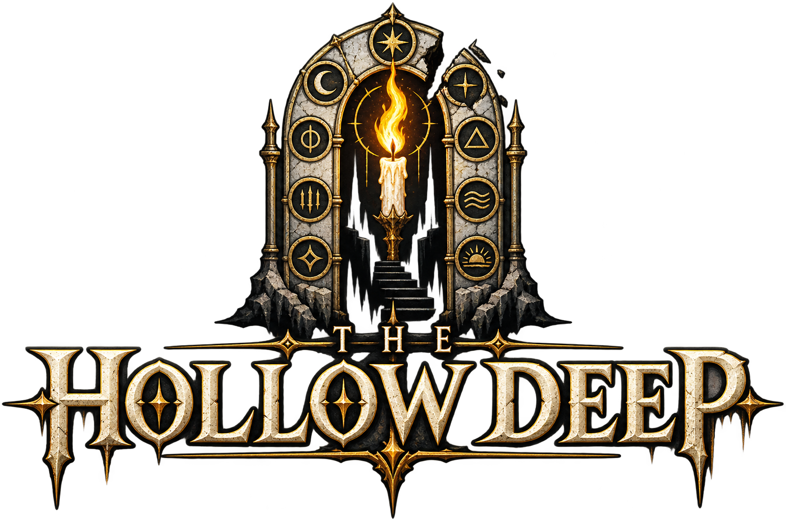

  

[Play The Hollow Deep](https://lzyang2000.github.io/Hollow-Deep/)

A 2D roguelike dungeon crawler that runs in the browser. You go down a
procedurally generated dungeon, fight demons, and see how deep you can get
before you die. The code draws every sprite on canvas and generates every sound,
so the game ships no image or audio files. The only images in the project are the
logo and the favicons.

## Story

Nine pillars were torn out of the world, and nine demons called Sovereigns sit on
the pieces. You go down to put them back. One Sovereign waits at depth 5, then 10,
15, and so on up to 45. Put out the ninth one and the deep tells you what it
actually is, then offers you a door. Take the stair up and the run is over. Take
the stair down and the Sovereigns come back in an order nobody chose.

## Run it

There is no build step, no dependency, and no server to start:

    open index.html

You can also double-click `index.html`. If your browser blocks something, serve
the folder instead:

    python3 -m http.server 8080    # then visit http://localhost:8080

Sound begins on your first click or keypress, because browsers do not let a page
play audio before you interact with it.

### Playing on a phone

The layout changes on a small screen. The view zooms out to about 30 m so the
light around you still fits on it, the minimap shrinks, and the bottom half of the
screen becomes two thumb sticks.

To play on your phone, serve the folder from your Mac and open it in the phone's
browser on the same Wi-Fi:

    python3 -m http.server 8080    # then visit http://<mac-ip>:8080

Add the page to your home screen to run it full screen.

## Put it on GitHub Pages

The site is static, so Pages serves it as it is:

    git remote add origin git@github.com:<you>/hollow-deep.git
    git push -u origin main

Then open the repository's Settings, then Pages, and choose "Deploy from a
branch", branch `main`, folder `/ (root)`. About a minute later the game is at
`https://<you>.github.io/hollow-deep/`. The `.nojekyll` file in the root tells
Pages to serve the files as they are instead of running them through Jekyll.

Hosting beats `file://` or a LAN address for phone play. Browsers only offer the
share sheet ("Save to Files") on a secure origin, so an HTTPS URL is what makes
saving a run work on an iPhone.

## Controls

| Input | Action |
| --- | --- |
| `W A S D` | Move |
| Mouse move or drag | Aim |
| Left click, hold to keep attacking | Attack |
| `Space` | Class ability, costs MP |
| `Shift` | Dodge |
| `1` / `2` | Drink a healing draught / a mana draught |
| `E` | Interact with a merchant or a portal |
| `I` or `Tab` | Open or close the pack. Pauses the run |
| `Esc` | Pause, or leave the shop or the pack |
| `V` | Change the zoom |
| `M` or `N` | Open or close the map of the whole floor. Pauses the run |
| `H` | Mute |
| `S` / `L` while paused | Save the run to a file / load one back |
| `R` while paused | Abandon the run |

In the merchant, click a row or press `1` to `9` to buy, and `E` or `Esc` to
leave. A deep counter can stock ten items, so the tenth one needs a click.

In the pack, `1` to `9` and `0` or the arrows pick a row, `E` wears it, `X` or a
right click sells it, `R` sorts it, `Q` and `F` drink, and clicking a worn item
takes it off. `I` or `Esc` closes the pack.

### Phone controls

The bottom half of the screen is split in two. Your left thumb moves, your right
thumb attacks.

| Gesture | Action |
| --- | --- |
| Press anywhere in the bottom left half | Move. The stick starts wherever your thumb lands. Moving less than 14 px does nothing, so a resting thumb does not walk |
| Tap in the bottom left half | Interact, when a merchant or a portal is under you |
| Press anywhere in the bottom right half | Attack continuously while you hold. Push to aim. Left unpushed, the attack aims at the nearest demon in the light |
| Tap in the bottom right half | One attack at the point you tapped |
| Drag above the two sticks | One-handed play. This finger moves you, and the aim points at the finger itself. Dragging never attacks by itself |
| Tap above the two sticks | Interact, or one attack at the point you tapped |
| DODGE and BLINK or SHIELD, the two circles left of the attack stick | Dodge, and the class ability. A dash and a spell are both things you do instead of a blow, so both belong to the thumb that is already swinging. They sit one above and one below the middle of that stick, at the same distance from it. The 1.9 s dodge cooldown shows as a ring and a countdown |
| TRADE or DOWN, above the upper of those two circles | Only appears when a merchant or a portal is under you |
| PACK, HEAL, MANA, under the health bar | Open the pack, drink a healing draught, drink a mana draught |
| Pause, top right corner of the screen, on the minimap | Pause menu: resume, pack, save, load, mute, abandon |

Because the two sticks are separate, you can walk north and attack east at the
same time, and lifting one thumb only affects that thumb. The dashed circles in
the bottom corners show where the sticks sit when nothing is touching the screen,
so you never have to line your thumb up with them.

## Classes

- Mage: shoots bolts that pass through demons and splash. 60 HP, 130 MP, 17 ATK,
  4.6 m/s. `Space` is Blink: 18 MP, 6 s cooldown, moves you 9 m along your aim
  through walls and always lands on open ground. Distance is a mage's defence, so
  heavy armour costs her more than the defence is worth.
- Knight: slow and heavy, with the most HP, free defence, the longest reach and
  the strongest knockback. 145 HP, 70 MP, 24 ATK, 3 DEF, 4.2 m/s. `Space` is
  Shield Wall: 22 MP, 10 s cooldown, 3.2 s of 70% damage reduction and immunity to
  knockback. A knight can walk an Imp down, but a Hellblade moves 4.7 m/s and will
  catch a knight who is standing in the open.

You can play a mage or a knight. Demons come in three types, and one of them, the
Hellblade, fights like a swordsman. Sword-shaped Sovereigns appear too. A save
file that names the Swordsman class loads as a knight and keeps its depth, gold,
gear and explored map.

Every class, demon and Sovereign is drawn with its own shape and its own colours,
so an Imp, a Hellblade and a Gorewarden are still three different silhouettes at
the edge of your light. The class select screen draws the same figure the game
uses, so the sprite you pick is the sprite that walks down the stairs.

## How a floor works

- Each floor is 150 m x 150 m and generated from a seed: 6 to 10 rooms of
  different sizes joined by corridors that bend, sometimes run two tiles wide, and
  loop back on each other, so there are no dead ends. Every open tile is
  reachable. About a third of the floor is walkable (7,650 m^2, 306 tiles), and
  the stairs down are about 100 m of corridor away, which is around 25 s of
  walking for a knight.
- Every floor has a name, built from a seeded word list and kept for the rest of
  the run, so depth 7 is the same place every time you replay that run. No two
  floors in one run share a name. Throne rooms are named from a separate list, so
  you can tell what kind of room you have walked into. The name appears on the
  entry banner, the lore card, the pause screen, the death screen and the big map,
  and shrinks when it is too long.
- Light reveals 15 m around you. Everything else is hidden, and ground you have
  already seen stays dimly remembered. The edge of the light moves slightly, and
  visibility uses its widest radius, so a chest near the edge does not flicker.
- The minimap in the top right is a 50 m square centred on you, and it shows the
  ground you have revealed. Once you find the portal it is marked, and an arrow
  points at it when it is off the minimap.
- Click or tap the minimap, or press `N`, to see the whole floor at full scale:
  every tile your light has revealed drawn clear of the dark, the explored
  percentage, a 50 m scale bar, and a box showing which part the minimap is
  looking at. Unexplored ground stays black, and demons, chests and urns only
  appear while they are in the light. The run pauses while the map is open. One
  press opens it and the next press closes it.
- The portal to the next floor is about half the maze's own walking span from the
  stairs: 75, 100 and 140 m of corridor at the 10th, 50th and 90th percentile. It
  is always inside a room, never in a corridor, doorway or alcove, with at least 2
  tiles (10 m) of clear floor all the way around it. Walking onto it does nothing.
  Stand in it and press `E`, or the DOWN button, or tap. You can stand on it, look
  around, and go back for a chest first.
- Floors are crowded. The first floor holds 29 demons, 11 chests and 15 urns, and
  the spawner reaches its cap of 85 demons, 18 chests and 32 urns by the low
  twenties. Urns break when you walk into them and are the main source of potions.
  Nothing spawns within 22 m of the stairs. Demons wake one at a time as they
  notice you, and the waking budget runs from 4 on the first floor to 14 deep
  down, so a big room commits that many to the chase and no more.
- The dungeon has nine regions, one per band of depths, and each has its own
  look. The floor, the wall colour, the colour of the dark, the torch flames, the
  litter on the ground and the words used for floor names all come from the same
  table, so every floor in a region looks like that region. Each region has three
  variations that appear in depth order, and every floor gets
  one prop type (chains, ash, runes, crystals, ribcages, banners) spread over it
  and absent from the next. The minimap and the big map use the same colours. All
  of it depends only on depth, so a save file rebuilds the floor it was saved on.

## Fighting

- Demons do not attack until they have seen you. All three types appear on every
  floor. Imps are the most common early on, and the heavier Gorewarden and
  Hellblade become relatively more common as you go down. Each demon sees slightly
  less far than your light reaches, so you usually notice them first. A demon that
  loses sight of you for a few seconds gives up the chase and drifts back.
- A melee attack only lands inside the red wedge on the floor. A Hellblade cuts
  110 degrees, a Gorewarden slams 150, your sword covers 105, and a Sovereign
  sweeps 150. Wind-ups lock onto where you were, so stepping behind a demon while
  it is winding up avoids the hit. The blade swings through the wedge: it cocks
  back during the wind-up, crosses the arc on the beat the damage lands, and
  overshoots past it. A landed hit leaves a flash in the shape of its own arc.
- Dodge (`Shift`, or the DODGE button on a phone) covers about 4.2 m in 0.2 s at
  21 m/s, once every 1.9 s. It gives you no invulnerability, you cannot steer once
  it starts, it cancels an attack you were about to land, and your next attack is
  late. Rock stops it and still uses the cooldown. It takes you the way you were
  walking, or the way you were aiming if you had stopped. The dash is drawn as a
  smear in your class colour, which is how you can tell it is spent.
- Out of combat you heal slowly. Once no demon on the floor can see you and you
  have taken no damage for five seconds, your HP starts to recover.
- Casting drains your mana faster than it comes back. After you stop, recovery
  takes 1.6 s to kick in again. A mage's whole pool empties in about 20 s of
  continuous fire, and after that each bolt costs about 2 s of waiting. One shot
  every two seconds costs nothing.
- On top of their base shapes every demon hits a quarter as hard again, swings a
  quarter as often again and covers ground a quarter as fast again. A Hellblade
  walks at 5.9 m/s against your 4.6, so you cannot simply outrun one forever; you
  break contact with Blink, Dodge and doorways. Imps are held to the old rule that
  a shooter never runs faster than a knight, which keeps a shooter fight a fight
  instead of a countdown. None of this shortens a wind-up, so the red wedge you
  dodge by stays the same length it always was.
- Demon stats grow as you get stronger, but on a slope 30% shallower, so a good
  run keeps getting stronger than the floor.

## Loot and the pack

- Kills, chests and broken urns drop equipment (attack or defence), upgrades
  (movement speed, attack speed, max HP or MP) or gold.
- Loot goes into a pack with ten rows. A find that fills an empty slot is worn for
  you. After that, only a clear improvement is worn automatically, and anything
  close is left in the pack for you to decide. When the pack is full, the item a
  new find displaces is discarded. Only worn items give bonuses, so taking
  something off costs you. Everything you carry can be sold.
- Heavy gear is a trade. A Greataxe and an Ash Rod at the same item level are not
  the same find: the heavy one gives about 20% more of its stat and pays for it in
  stride, up to roughly 0.5 m/s once both slots are heavy. Every item shows what
  it costs, for example `-0.26 m/s`. The comparison against what you are wearing
  is scored as stats minus stride, at a rate your class cares about: a mage values
  1 m/s at 6 ATK, a knight at 2.5. That is why the same coat is worn automatically
  by a knight and left in the pack by a mage.

## Boss floors and the merchant

- Every fifth floor is a throne room: a bare 50 m x 50 m chamber in the middle of
  the floor with no maze, a merchant near the stairs, and a Sovereign in the
  centre.
- The Sovereign does not attack until you hit it once. The portal appears where it
  dies, so it is never standing in a passage.
- Sovereigns are bigger, hit harder, and wear heavy armour: 330 HP with 11 DEF for
  the knight type, 300 with 10 for the blade type, 270 with 8 for the mage type.
  If you hold a lot of clear ground away from it, it winds up over about 3.5 s and
  gains 40% more speed and 25% shorter wind-ups, and it shows you this. Each type
  has an answer at range. The knight throws its shield, and its charge leads your
  movement and shakes the ground where it lands. The blade lunges 14 m and hops
  again if it falls short. A mage's volley leads your movement and arrives spread
  out instead of all at once.
- The merchant sells equipment, upgrades, HP and MP refills, and potions. Its
  stock is better than the best chest on that floor and never below Fine, and the
  shelf gets longer as you go down. Prices grow with the square of the depth and
  carry a five times markup: the first throne room asks 925 for a weapon and the
  tenth asks 4,350, against a purse of roughly 2,000 to 6,000. That makes it one
  big choice per boss floor. Potions stay cheap.
- There are twelve named Sovereigns. The nine you are sent down for sit at depths
  5 through 45, and the ninth is "The Ninth Seal, Unmade". What happens when it
  falls is its own section below.

## The ninth seal, and the echoes under it

- Killing the Sovereign at depth 45 ends the errand you were sent down for. A six
  card cinematic plays, one card at a time, over a hymn with no drums in it, and
  it says what the deep turns out to be. Any key or a click turns a card.
- Then you choose a door. "Climb out with the report" (`R`) ends the run on a
  victory screen that lists your depth, the seals you put out, the demons you
  killed, the coin you carried and the time it took. "Go back down into the
  echoes" (`Enter`) puts you back on depth 45 with the portal still open and the
  merchant still standing there, and the run carries on from depth 46 with your
  gear and your purse.
- Below 45 the throne rooms are dealt from a deck. Each run shuffles the twelve
  named Sovereigns and uses them in that order, so one run might meet the Ash
  Herald at 50 and the Blade of the Choir at 60, and the next run deals them
  differently. Every twelfth throne wraps the deck, and those thrones arrive with
  another cycle of scaling on them and a heavier prefix: "Echo of", then "Second",
  then "Hollow", "Ashen", "Unquiet", "Last".
- A Sovereign keeps its own music when it comes back as an echo, so a shuffled
  deck also shuffles the score.
- The deck and the story flags are stored in the save file, so a saved run
  resumes with the same thrones waiting at the same depths, and the cinematic does
  not play at you twice.

## Saving and loading

The pause menu offers "Carry this run out", which downloads the run as a small
JSON file, and "Take up a saved run", which loads one back. You can also drop the
file onto the window.

A save stores the floor's seed and only what you changed since: dead demons,
opened chests, broken urns, and the ground you revealed. Below the ninth seal it
also stores the throne deck for the run and whether you have already seen the
ending. A file is a few
kilobytes, and it cannot hand you a floor you never walked. Numbers and indices
read from a file are clamped or dropped, and editing a file cannot skip a boss
portal.

## Sound

Music and every sound effect are generated while the game runs, so there are no
audio files. Each Sovereign has its own piece, with its own tempo (72 to 126 bpm),
key, mode, eight-note motif, lead instrument (plucked string, bell, bowed saw, or
two reeds slightly out of tune), drum pattern (march, war, pulse, triplet, slow,
or none), and one instrument used only by it (anvil, choir, bass roar, bowed
pair, bell). The piece belongs to the Sovereign, so an echo of one comes back with
the same music, and none of it plays in the corridor outside its room.

The ending has its own score: 52 bpm, whole bar pads, a bell that resolves once,
and no drums at all. It is the only music in the game that never argues with
anything.

A hit on a body is a low thud: a sawtooth falling through a low-pass filter that
is closing, with a band of grit over the top. It starts at 110 to 170 Hz and drops
from there, and nothing in the hit family opens above the low mids. An urn coming
apart is an octave lower than a body hit.

## Development

    node tmp/test_maze.js    # maze invariants: reachability, borders, arenas
    node tmp/smoke.js        # loads the real files, 9000 frames of headless play,
                             # and counts the drawing operations of every shape:
                             # the three demons and three Sovereigns must be three
                             # different drawings in three different palettes
    node tmp/balance.js      # no-cheat difficulty bot across both careers
    node tmp/duel.js         # worst-case stand-and-trade fights, career vs demon
    node tmp/perf.js         # cost of a full 180-demon floor, and level generation
    sh tmp/dump.sh           # every screen, desktop + iPhone portrait + landscape,
                             # through headless Chrome; reports any window.onerror hit
    sh tmp/shots3.sh         # writes the screenshot set into tmp/shots/

`tmp/` is scratch and is git-ignored. `docs/SPEC.md` holds the full
specification and acceptance criteria; `docs/ARCHITECTURE.md` explains the
file layout and the load order.

To jump straight into a level while developing, use the dev flags:

    index.html?auto=mage&depth=21     # start that career at that depth
    index.html?select=1               # stop at the career select screen
